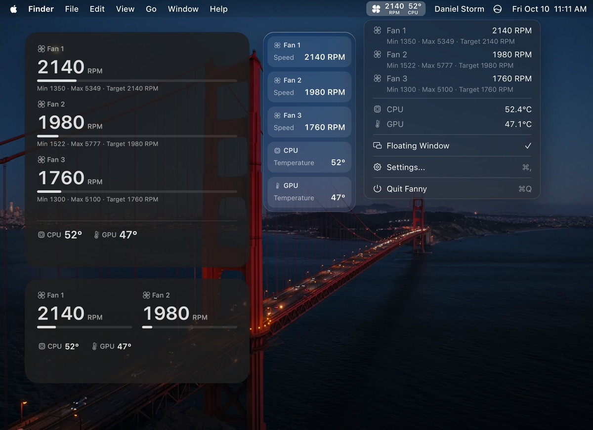

# Fanny

If you're looking to download this application, please visit the [latest releases page](https://github.com/DanielStormApps/Fanny/releases/latest) and download the `Fanny_<version>.zip` file, such as `Fanny_26-1-0.zip`.

Fanny is a free Widget and Menu Bar application to monitor your Mac's fans.

- Compact design allowing you to keep an eye on your system's fans and CPU/GPU temperature while not cluttering up your work space.
- Get information on current speed, target speed, minimum speed, maximum speed, number of fans, and CPU/GPU temperature.
- Simply open the Widget or Menu Bar application to glance at your Mac's fan stats.

Fanny is open source and only reads your Mac's sensors. It never changes how the fans run.

#### Download

Download the latest version from [FannyWidget.com](https://www.fannywidget.com) or [GitHub Releases](https://github.com/DanielStormApps/Fanny/releases/latest). Fanny checks GitHub for a new version once a day and shows Update Available in its menu.

#### Requirements

- macOS 27 or later

#### Building From Source

1. Install Xcode 27.1 or later.
2. Open `fanny/fanny.xcworkspace` and select the `fanny-macOS` scheme. Swift packages resolve on first open.
3. Duplicate `fanny/Xcode Config/Local.example.xcconfig`, rename the copy to `Local.xcconfig` (the gitignored name), and fill in `DEVELOPMENT_TEAM = <your team ID>`. The app and widget sign with that team, and their shared app group becomes `<your team ID>.com.fannywidget` on its own.
4. Build and run.

The app is not sandboxed, because it reads the SMC through IOKit. The widget extension is sandboxed and only reads the readings the app saves to the shared app group.

#### Analytics

`fanny/fanny-macOS/Config/config.example.json` is committed with empty analytics IDs. A build phase copies `config.json` and `GoogleService-Info.plist` into the app only when they exist, and both are gitignored. Builds from a fresh clone use `config.example.json`, so TelemetryDeck, Firebase Analytics, and Crashlytics stay off. Official release builds include those files and send anonymous usage data and crash reports. No build ever sends fan speeds or temperatures.

#### License

[MIT license](LICENSE)
